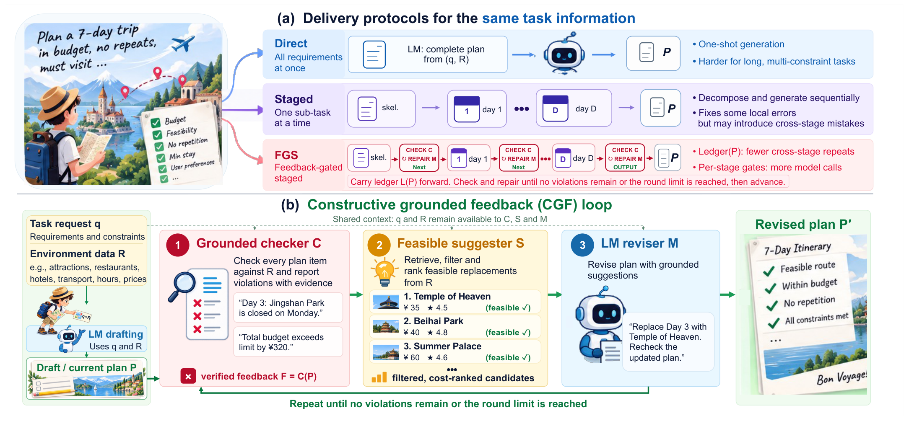
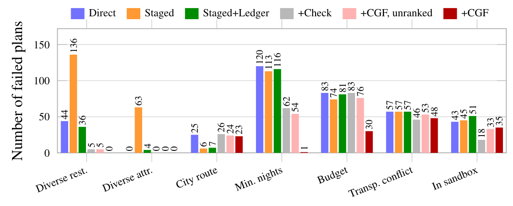

<h1 align="center">Constructive Grounded Feedback for Small LM Agents on Constraint-Rich Long Tasks</h1>

<p align="center">
  
  
  
  
  
  
</p>

<p align="center">
  <b>🧭 Small LM agents keep breaking long, constraint-rich plans. Splitting the task into stages doesn't fix it. 🧩</b><br/>
  <b>✨ Telling the model <i>what</i> is wrong <i>and</i> handing it a short list of feasible fixes does. ✨</b>
</p>

<p align="center">
  🗺️ <a href="#-tldr">TL;DR</a> ·
  🍬 <a href="#-how-cgf-works">How it works</a> ·
  🏆 <a href="#-results">Results</a> ·
  🛠️ <a href="#%EF%B8%8F-setup">Setup</a> ·
  🏃 <a href="#-run-the-experiments">Run</a> ·
  📦 <a href="#-released-plans--reproducing-every-number">Plans</a> ·
  📝 <a href="#-citation">Cite</a>
</p>

---

## 🌟 TL;DR

- 🧳 **The problem.** Multi-day itineraries, meeting schedules and multi-city trips bundle many interacting constraints (grounding, opening hours, non-repetition, minimum stays, budgets, travel times, flight networks…). Open 8–9B models fail them all the time.
- 🪜 **Staging is not the fix.** Feeding the *same* information one sub-task at a time never raises strict success and loses constraints that span stages (repeated restaurants, stays that no longer add up to the trip length).
- 🍭 **CGF is.** *Constructive grounded feedback* is a training-free **check → suggest → revise** loop: a checker verifies every plan item against the environment's own data, and each violation comes with **filtered, cost-ranked feasible replacements**. It beats violation-only feedback in every model–task setting at about the same number of model calls.
- 🔬 **Why it works.** Where the constraints define a feasible set (TravelPlanner, calendar scheduling), random candidate lists of the same size from the same pool do **not** help. The gain comes from filtering and ranking, i.e. from doing the search that a small model does not do reliably in context.

---

## 🍬 How CGF works

<p align="center">
  
</p>

<p align="center"><sub><b>Fig. 1.</b> Overview. (a) Direct, staged and feedback-gated staged delivery of the same task information (stages: days of an itinerary, friends of a meeting schedule, cities of a trip). (b) The CGF loop: a grounded checker reports violations, a suggester returns filtered, cost-ranked feasible replacements, and the LM revises; without S, the loop provides violation-only feedback on a direct draft (Direct+Check, abbreviated as +Check); with S, it provides CGF (Direct+CGF, abbreviated as +CGF). Applying CGF after every stage yields FGS+CGF.</sub></p>

A task is a request **q** plus reference data **R** from the environment (flights, trains, restaurants, attractions, hotels, distances, calendars…). The checker **C**, the suggester **S** and the LM reviser **M** all see the same **q** and **R**.

| | Step | What happens | Example 💬 |
|:-:|---|---|---|
| 🔍 | **Check** (`C`) | Verify every plan item against **R** and report violations in plain language. | *"Day 3: the stay does not meet the hotel's minimum nights."* |
| 💡 | **Suggest** (`S`) | Return a short list of feasible replacements for each violation type, filtered against the same constraints and sorted by cost or time. | *"Stays admitting the planned nights (cheapest first): …"* |
| ✍️ | **Revise** (`M`) | The LM rewrites the complete plan from **q**, **R**, the draft, the violations and the candidates. | A new full plan ✨ |
| 🔁 | **Repeat** | Stop when no violation is left (or after `r = 3` rounds) and keep the plan with the fewest violations. | |

🧠 **The candidates are only a filtered, sorted view of R, which is already in the prompt.** CGF adds no new information; it performs the search and comparison for the model.

🙈 **What the checker never sees:** gold plans, oracle constraint annotations and the official evaluators. It reads only the environment's data and the task statement.

### 🧪 Methods compared

| Paper name | 🧳 TravelPlanner (`tp/`) | 📅 NATURAL PLAN (`np/`) | 🏯 ChinaTravel (`ct/`) | What it is |
|---|---|---|---|---|
| **Direct** | `direct` | `direct` | `direct` | the whole plan in one call |
| **Staged** | `staged` | `staged` | `staged` | a skeleton first, then one stage at a time |
| **Staged+Ledger** | `staged_ledger` | – | – | Staged + a program-computed ledger `L(P)` of used restaurants/attractions, money spent and transport modes |
| **+Check** | `direct_repair` | `check` | `check` | violation-only feedback (LLM-Modulo style) |
| **+CGF** ⭐ | `direct_cgf` | `cgf` | `cgf` | violations + filtered, cost-ranked candidates |
| **+CGF, unranked** | `direct_cgf_unranked` | `cgf_unranked` | `cgf_unranked` | random candidates of the same size from the same pool |
| **FGS** | `staged_verified` | – | – | feedback-gated staging with violation-only feedback |
| **FGS+CGF** | `staged_verified_cgf` | `fgs_cgf` | `fgs_cgf` | every stage gated by CGF |

---

## 🏆 Results

Strict success (%) on TravelPlanner and NATURAL PLAN, commonsense micro pass rate (%) on ChinaTravel (strict success is 0 % for every 8–9B run there). Each cell is **Qwen3.5-9B / Qwen3-VL-8B / Hermes-3-8B**. Calendar scheduling has no stages (–).

| Method | 🧳 TravelPlanner | 🏯 ChinaTravel | 📅 Calendar | 🤝 Meeting | ✈️ Trip |
|---|---|---|---|---|---|
| Direct | 2.2 / 1.7 / 0.0 | 78.1 / 66.5 / 53.8 | 34.6 / 26.8 / 17.4 | 22.3 / 21.0 / 14.2 | 21.5 / 19.0 / 11.6 |
| Staged | 2.2 / 0.0 / 0.0 | 71.9 / 71.6 / 52.1 | – | 11.4 / 18.9 / 8.3 | 4.4 / 4.8 / 4.2 |
| +Check | 8.9 / 9.4 / 0.0 | 78.3 / 68.1 / 58.9 | 82.6 / 69.2 / 28.1 | 45.6 / 35.2 / 21.2 | 37.0 / 25.4 / 15.6 |
| **+CGF** ⭐ | 25.0 / 32.2 / 6.7 | 81.4 / 75.5 / 66.7 | 82.7 / 76.0 / 61.8 | 47.3 / 35.9 / 21.5 | 39.3 / 26.0 / 17.0 |
| +CGF, unranked | 7.8 / 12.2 / 0.6 | 84.7 / 77.1 / 64.7 | 61.5 / 55.4 / 23.4 | 47.3 / 36.1 / 22.4 | 38.4 / 26.6 / 14.9 |
| FGS+CGF | 25.0 / 33.3 / 7.8 | 79.6 / 86.0 / 71.0 | – | 43.9 / 42.6 / 33.4 | 36.6 / 26.9 / 18.6 |

🎯 **Highlights**

- 🥇 Among Direct, Staged, +Check and +CGF, **+CGF scores highest in all 15 model–task settings**.
- 📈 Pooled over the 12 settings with a strict metric, +CGF solves **965** tasks that +Check misses against **381** the other way (exact McNemar, p ≈ 1×10⁻⁵⁸).
- 🎲 Random candidates (`+CGF, unranked`) stay near +Check on TravelPlanner and fall below it on calendar scheduling, so the gain comes from **filtering and ranking**.
- 🪜 Gating every stage with CGF (FGS+CGF) helps on some settings and hurts on others, at 9.6–14.0 instead of 2.9–4.0 model calls per task.

<p align="center">
  
</p>

<p align="center"><sub><b>Fig. 2.</b> TravelPlanner plans (of 180) failing each constraint (Qwen3.5-9B): delivery without feedback (Direct, Staged, Staged+Ledger) and feedback on a direct draft (+Check; +CGF, unranked; +CGF). Staging fixes route errors but multiplies cross-stage repetition failures, which the ledger markedly mitigates; CGF removes nearly all minimum-stay and most budget failures left by +Check.</sub></p>

---

## 🗂️ Repository map

```text
constructive-grounded-feedback/
├── 🧳 tp/                     TravelPlanner (sole-planning, 180 validation queries)
│   ├── run_tp.py              all methods (direct / staged / ledger / +Check / +CGF / FGS …)
│   ├── ledger.py              grounded checker C, ledger L(P), suggester S
│   ├── score_tp.py            official evaluator wrapper + per-constraint breakdown
│   ├── paired.py              exact McNemar tests
│   └── make_figs.py · make_table2.py
├── 📅 np/                     NATURAL PLAN (calendar 1,000 · meeting 1,000 · trip 1,600)
│   ├── np_run.py              Direct / +Check / +CGF / unranked (official 5-shot prompts)
│   └── np_staged.py           Staged / FGS+CGF for meeting and trip
├── 🏯 ct/                     ChinaTravel (100 English phase-2 queries, tool-free)
│   ├── ct_run.py              all methods
│   ├── ct_ref.py              builds the reference block R for each query
│   ├── ct_expand.py · ct_eval.py · ct_data.py · ct_common.py · ct_tokstats.py
│   └── SEMANTICS.md           notes on the official evaluator's checks
├── 📊 analysis/
│   ├── aggregate.py           rebuilds results/aggregate.json (every paper number)
│   ├── gen_tables.py · make_report.py
│   └── figures/fig_fail.tex   pgfplots source of Fig. 2
├── 📦 results/
│   ├── aggregate.json         all numbers reported in the paper
│   └── runs.tar.xz            every plan, log and score behind them
└── 🖼️ assets/figures/         Fig. 1 and Fig. 2 from the paper
```

---

## 🛠️ Setup

```bash
# 🐍 environment
python -m venv .venv && source .venv/bin/activate
pip install -r requirements.txt

# 📚 benchmarks (each comes with its own license and data download steps)
mkdir -p third_party && cd third_party
git clone https://github.com/OSU-NLP-Group/TravelPlanner      # + download its database/ as described in its README
git clone https://github.com/google-deepmind/natural-plan
git clone https://github.com/LAMDASZ-ML/ChinaTravel           # English sandbox (database_en)
cd ..
```

Paths can be overridden with environment variables 🌱

| Variable | Default | Used by |
|---|---|---|
| `TP_ROOT` / `TP_DB` | `third_party/TravelPlanner` / `…/database` | `tp/` |
| `NP_ROOT` | `third_party/natural-plan` | `np/` |
| `CT_REPO` | `third_party/ChinaTravel` | `ct/` |
| `CT_QUERY_CSV` | `third_party/ChinaTravel_phase2/competition_test.csv` | `ct/` (the 100 English phase-2 test queries) |
| `CT_REFS` | `ct/refs` | `ct/ct_run.py` |
| `TP_MODEL` / `TP_PORTS` | `qwen3.5-9b` / `8000` | `tp/run_tp.py` |

### 🤖 Serve a model

All runs use an OpenAI-compatible [vLLM](https://github.com/vllm-project/vllm) server on `127.0.0.1`, greedy decoding and JSON-schema-constrained output for itineraries.

```bash
vllm serve Qwen/Qwen3.5-9B --served-model-name qwen3.5-9b --port 8000 \
  --dtype bfloat16 --max-model-len 32768 \
  --structured-outputs-config '{"backend": "xgrammar", "disable_any_whitespace": true}'
```

🎛️ The scripts already send `temperature=0` and `enable_thinking=false` with every request. ChinaTravel prompts are about 17k tokens, hence the 32k context.

🧩 The other two models are `Qwen/Qwen3-VL-8B-Instruct` (text only) and `NousResearch/Hermes-3-Llama-3.1-8B`. Keep `disable_any_whitespace` on for every model so that JSON decoding behaves the same. Flag names can differ between vLLM versions; we used vLLM 0.11–0.17.

---

## 🏃 Run the experiments

```bash
# 🧳 TravelPlanner
export TP_MODEL=qwen3.5-9b TP_PORTS=8000
python tp/run_tp.py --method direct_cgf --out runs/travelplanner/q35/direct_cgf.jsonl
python tp/score_tp.py runs/travelplanner/q35/direct_cgf.jsonl        # writes …jsonl.score.json

# 📅 NATURAL PLAN
python np/np_run.py    --task calendar --method cgf     --model qwen3.5-9b --ports 8000 --out runs/naturalplan/q35/calendar_cgf.jsonl
python np/np_staged.py --task trip     --method fgs_cgf --model qwen3.5-9b --ports 8000 --out runs/naturalplan/q35/trip_fgs_cgf.jsonl

# 🏯 ChinaTravel
python ct/ct_ref.py --dump_dir ct/refs                                  # build R once (deterministic subset)
python ct/ct_run.py --method cgf --model qwen3.5-9b --ports 8000 --out runs/chinatravel/q35/cgf
```

💡 Swap `--method` for any name in the [methods table](#-methods-compared). Every run writes the plans plus a `.meta.json` with the number of model calls and tokens.

---

## 📦 Released plans & reproducing every number

`results/runs.tar.xz` holds **every plan, repair log and score** behind the paper (3 models × 5 task families × all methods). The numbers can be rebuilt without a GPU 🎉

```bash
tar -xJf results/runs.tar.xz -C results/
python analysis/aggregate.py > results/aggregate.json                   # ✅ identical to the shipped file
python tp/paired.py direct_repair direct_cgf final                      # 🧮 McNemar: 3 vs 32 (Qwen3.5-9B)
SUB=qvl python tp/paired.py direct_repair direct_cgf final              # 🧮 1 vs 42 (Qwen3-VL-8B)
python analysis/gen_tables.py results/aggregate.json tables/            # 📋 LaTeX table rows
```

| Folder in `results/runs/` | Files | Content |
|---|---|---|
| `travelplanner/<model>/` | `<method>.jsonl` · `.meta.json` · `.score.json` | plans in the official format, calls/tokens, official scores + per-query rows |
| `naturalplan/<model>/` | `<task>_<method>.jsonl` · `.meta.json` | raw answers, repair logs, official correctness |
| `chinatravel/<model>/<method>/` | `<uid>.json` · `<uid>.hl.json` · `_meta.json` · `_eval.json` | expanded plans, model output + logs, summary, official per-query evaluation |

`<model>` ∈ { `q35` = Qwen3.5-9B 🟣, `qvl` = Qwen3-VL-8B 🔵, `hermes` = Hermes-3-8B 🟠 }

⚠️ Plans that crash the official TravelPlanner evaluator are counted as undelivered (`*.sanitized.jsonl`). A truncated, unparsable or unevaluable output counts as a failure everywhere.

---


## 📝 Citation

```bibtex
@inproceedings{zhang2027cgf,
  title     = {Constructive Grounded Feedback for Small {LM} Agents on Constraint-Rich Long Tasks},
  author    = {Zhang, Hui and Yue, Binghui and Deng, Wenbo},
  booktitle = {IEEE International Symposium on Circuits and Systems (ISCAS)},
  year      = {2027},
  note      = {Submitted}
}
```

## 💌 Acknowledgements

Huge thanks to the authors of 🧳 [TravelPlanner](https://github.com/OSU-NLP-Group/TravelPlanner), 📅 [NATURAL PLAN](https://github.com/google-deepmind/natural-plan), 🏯 [ChinaTravel](https://github.com/LAMDASZ-ML/ChinaTravel) and ⚡ [vLLM](https://github.com/vllm-project/vllm). Their benchmarks and evaluators are used as released; please follow their licenses.

## 📄 License

Code in this repository is released under the [MIT License](LICENSE). Benchmark data is **not** redistributed here.

<p align="center">
  <sub>Made with 🧋, 🗺️ and lots of ✅ · questions and issues are very welcome 🐣</sub>
</p>
